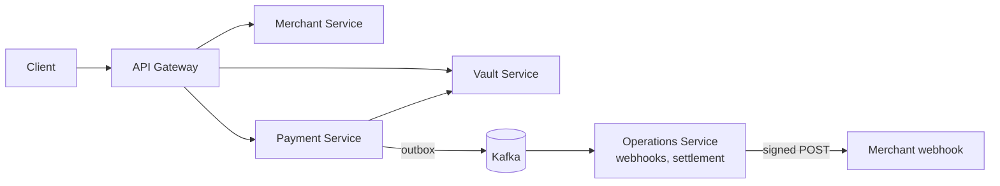

# Order and Payment Processing Platform

A multi-service Java / Spring Boot backend that models a payment gateway: merchants sign up, get API keys, create orders and
pay them (UPI, card, net banking, all **simulated**), receive signed webhooks, and are settled. It is a learning and portfolio
project; there is **no connection to a real payment processor**.

## Architecture



| Service | Responsibility |
|---|---|
| api-gateway-service | JWT / API-key authentication, rate limiting, routing |
| merchant-service | signup/login, API keys, webhook configuration |
| payment-service | orders, payments, payment state machine, transactional outbox, bank simulator |
| vault-service | card tokenisation (AES-GCM), simulated card charge |
| operations-service | Kafka consumer, signed webhook delivery with retries and dead letter, settlement |
| config-service / discovery-service | Spring Cloud Config and Eureka |
| common-lib | shared code (idempotency, rate limiters, money type, errors) |

Details, sequence diagram and design notes: [docs/ARCHITECTURE.md](docs/ARCHITECTURE.md).

## Technology
Java 25, Spring Boot 4.1, Spring Cloud 2025.1, Spring Data JPA / Hibernate, PostgreSQL 16, Redis 7, Apache Kafka, Resilience4j, ShedLock,
MapStruct, Docker Compose, Zipkin, JUnit 5 / Mockito / AssertJ, JMeter.

## Run it locally

**Prerequisites:** JDK 25 (`java -version`), Docker Desktop. Maven is not needed (each module has `mvnw`).

```powershell
copy .env.example .env          # optional, only to change the local PostgreSQL password
docker compose down -v          # one time: clean database (deletes local test data)
.\run-all.bat                   # Windows; use ./run-all.sh on macOS / Linux
```
`run-all` starts PostgreSQL, Redis, Kafka and Zipkin, builds `common-lib`, then starts every service in order and waits for each port.
Configuration comes from [`local-config/`](local-config) through the config server (profile `native`); no GitHub account or private
repository is needed.

| Service | URL |
|---|---|
| API gateway | http://localhost:8081 |
| Eureka | http://localhost:8761 |
| Config server | http://localhost:8888 |
| Zipkin | http://localhost:9411 |
| merchant / payment / operations / vault | 9010 / 9020 / 9030 / 9040 (bound to localhost only) |

Health check: `Invoke-RestMethod http://localhost:8081/actuator/health`.

### Troubleshooting
| Symptom | Fix |
|---|---|
| `invalid value for parameter "TimeZone": "Asia/Calcutta"` | The scripts set `JAVA_TOOL_OPTIONS=-Duser.timezone=Asia/Kolkata`. When starting a service by hand, set it first (`$env:JAVA_TOOL_OPTIONS="-Duser.timezone=Asia/Kolkata"`) |
| `Could not locate PropertySource ... localhost:8888` | config-service is not running yet; start it first |
| `Port 8080 was already in use` | the gateway uses 8081; change `server.port` in `local-config/api-gateway-service.yaml` if needed |
| `password authentication failed` / missing database | `docker compose down -v`, then start again |
| Services fail right after the first database start | wait 20 s and start them again |

## Try the API
```bash
GW=http://localhost:8081
curl -s -X POST $GW/v1/auth/signup -H 'Content-Type: application/json' \
  -d '{"name":"Demo","email":"demo@example.com","password":"Passw0rd!123","businessName":"Demo Shop","businessType":"PROPRIETORSHIP"}'
TOKEN=$(curl -s -X POST $GW/v1/auth/login -H 'Content-Type: application/json' \
  -d '{"email":"demo@example.com","password":"Passw0rd!123"}' | jq -r .accessToken)
curl -s -X POST $GW/v1/merchants/api-keys -H "Authorization: Bearer $TOKEN" -H 'Content-Type: application/json' \
  -d '{"environment":"TEST"}'                      # returns keyId + keySecret (shown once)

# server-to-server calls use HTTP Basic with the API key
curl -s -X POST $GW/v1/orders -u KEY_ID:KEY_SECRET -H 'Content-Type: application/json' \
  -d '{"amount":{"amountUnits":50000,"currency":"INR"},"receipt":"order-1"}'
curl -s -X POST $GW/v1/payments -u KEY_ID:KEY_SECRET -H 'Content-Type: application/json' \
  -H 'X-Idempotency-Key: 6f1d2c1e-0000-4000-8000-000000000001' \
  -d '{"orderId":"ORDER_ID","method":"UPI","methodDetails":{"vpa":"test@upi"}}'
curl -s $GW/v1/payments/PAYMENT_ID -u KEY_ID:KEY_SECRET
```
`amountUnits` is in paise (50000 = Rs 500). Magic values of the simulator: UPI VPA `fail@okaxis` fails, card number `4000000000000002` is declined.
Other endpoints: orders (get, list payments, cancel), payment capture, API-key list/rotate/revoke, webhook configuration, card tokenisation (`/v1/vault/tokenize`).

## Tests
- **Unit tests** (no infrastructure): `mvnw test` per module, see [docs/TESTING.md](docs/TESTING.md).
- **End-to-end verification** (about 80 checks, including database assertions): `powershell -ExecutionPolicy Bypass -File .\verify-all.ps1 -Gateway http://localhost:8081`
- **Load test:** [loadtest/README.md](loadtest/README.md).


Environment of the end-to-end runs: Windows, JDK 25.0.2, Docker Desktop. CI has not been run.

## Known limitations
- Payment processing is **simulated**; no real PSP, no ledger, **no refund API** (entity and events exist, no logic).
- Merchants stay in `PENDING_KYC` (no activation endpoint), so nightly settlement does not run end to end.
- Webhook target URLs are not restricted (SSRF risk); redelivered Kafka events are not deduplicated.
- Schema is created by Hibernate `ddl-auto: update`; there are no migrations.
- Development secrets are in `local-config/`; use a secret manager anywhere shared.
.

## Credits, licence and attribution
The project is an extension of a course project.