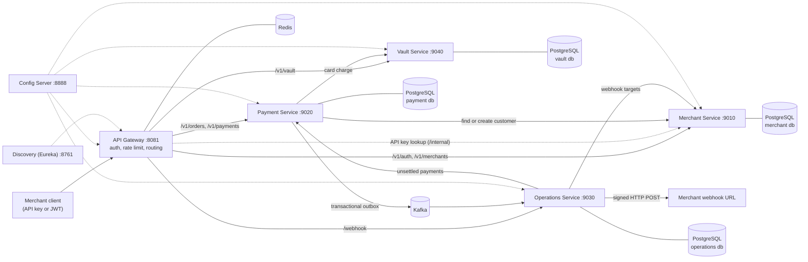
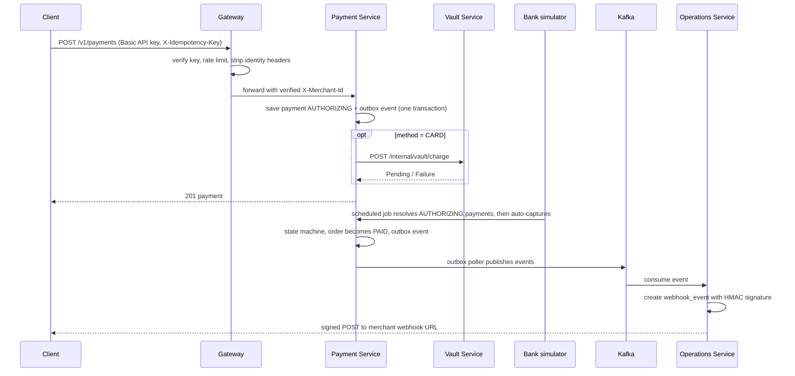

# Architecture

Everything in this document was checked against the source code unless marked otherwise.

## Component diagram

## Services

| Service | Port | Responsibility | Data |
|---|---|---|---|
| api-gateway-service | 8081 | Authenticates every request (JWT for dashboard users, HTTP Basic API key for server-to-server), strips and re-adds identity headers, rate limits per API key and per IP for login/signup, routes to services | Redis (API-key cache, rate-limit counters) |
| merchant-service | 9010 | Signup/login, API keys (create, list, rotate, revoke), webhook configuration, customers | `pay-merchant-db` |
| payment-service | 9020 | Orders, payments, state machine, bank-callback simulator, transactional outbox, settlement queries | `pay-payment-db` |
| vault-service | 9040 | Card tokenisation (AES-GCM encrypted PAN), simulated card charge | `pay-vault-db` |
| operations-service | 9030 | Consumes payment events from Kafka, delivers signed webhooks with retry and dead-letter, nightly settlement, settlement outbox | `pay-operations-db` |
| config-service | 8888 | Spring Cloud Config Server. Reads `local-config/` (profile `native`) or a Git repository | files |
| discovery-service | 8761 | Eureka server | in memory |
| common-lib | n/a | Shared library: money type, exceptions, idempotency filter, rate limiters, merchant context, DTOs | n/a |

## Payment flow

## State machine (payment-service)
`CREATED -> AUTHORIZING -> AUTHORIZED -> CAPTURING -> CAPTURED -> SETTLED`.
Failures: `AUTHORIZING -> FAILED`, `CAPTURING -> AUTHORIZED` (capture failed, retry possible). Illegal transitions throw
`InvalidStateTransitionException` (HTTP 409). Every transition is written to `payment_transition_log`.

## Cross-cutting mechanisms (verified in code)

| Concern | Implementation |
|---|---|
| Idempotency | Servlet filter in common-lib stores the response in Redis keyed by merchant + method + path + `X-Idempotency-Key`; payments also have a unique DB index on (merchant, idempotency key) |
| Rate limiting | Redis-backed, selectable: fixed window, sliding window, sliding window (Lua), token bucket (`app.rate-limit.method`) |
| Transactional outbox | `outbox_event` rows written with the business change; scheduled poller publishes to Kafka (5 s timeout per event, 3 attempts, then FAILED) |
| Scheduled jobs | ShedLock (Redis) so only one instance runs each job |
| Webhooks | HMAC-SHA256 signature over the exact body sent; retry with back-off up to 7 attempts, then dead-letter table |
| Resilience | Resilience4j `@Retry`, `@CircuitBreaker` on service-to-service calls, `@Bulkhead` on the vault card processor |
| Concurrency control | `PESSIMISTIC_WRITE` locks on order/payment rows for state changes |
| Schema management | Hibernate `ddl-auto: update` (there are no migration scripts) |
| Observability | Actuator health, Zipkin tracing (trace ids appear in the logs). Prometheus/Grafana configuration exists under `observability/` but was **not verified**. No custom correlation-id header |
| Secrets | API-key secrets BCrypt-hashed; card numbers AES-GCM encrypted; webhook secrets AES-GCM encrypted |

## Environments
- **Local (verified by the owner):** `docker-compose.yml` for PostgreSQL, Redis, Kafka, Zipkin; services started with `run-all.bat`.
- **Kubernetes/kind (`k8s/`):** manifests exist; **not tested in this review**. They reference the *original author's* Docker images, so they would not run this repository's code. See `docs/REPOSITORY_AUDIT.md`.
